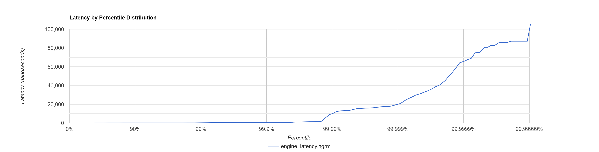
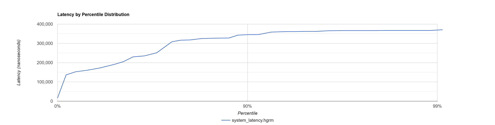

# C++ Low-Latency Matching Engine w/ Limit Order Book


A limit order book matching engine written in modern **C++23**, with cache-friendly data structures and my own personal reliable-UDP networking library [maroof-net](https://github.com/smhussa22/maroof-net). Price-time (FIFO) matching, single-threaded authoritative matching core, pre-allocated memory, and zero heap allocations on the hot path.

The repository is heavily commented in layman's terms, as I was learning about matching engines and order books while building this. For those who don't want to scrape the code, a brief summary is below.

# How It Works (Brief Summary)

An **exchange** matches buyers with sellers. At the center of every exchange is a **limit order book**. A limit order book is a running list of all buy orders (bids) and sell orders (asks) organized by price. A **matching engine** is the program that pairs incoming orders against the book using **price-time priority**: best price first, oldest order first among orders at the same price.

The architecture:

```
synthetic traders → maroof-net → exchange server → command queue → single matching thread → order book
                                                                                                 │
                                                             outbound queue ← exchange listener ─┘
                                                                     │
                                                         server thread drains, sends to clients
```

- **One authoritative matching thread** owns the book. All network callbacks drop commands onto a thread-safe queue; they never touch the book directly. This means **zero locks on the hot path.** The matching thread drains the queue at full speed.
- **Flat vectors indexed by price** store the two sides of the book. Finding a level is a direct array access instead of a tree walk.
- **Pre-allocated order pool** hands out slot indices from a free list. Resting orders live side-by-side in one contiguous block, which keeps the cache warm and means (most importantly) **zero heap allocations per order**.
- **Linked-list FIFO queue per price level** (using indices, not pointers) gives O(1) cancel of any order plus natural time priority on matches.
- **Outbound queue** mirrors the inbound one in reverse: the matching thread serializes events into owned bytes and pushes them to a queue; the server thread drains and transmits, so `Connection` state is only ever touched by one thread.
- **Templated listener system** lets the matching engine fire callbacks (`on_trade`, `on_order_added`, etc.) without any virtual dispatch. The listener type is known at compile time, so calls get inlined.

Supported order types: 
`GTC` (Good Till Cancelled, rests in the book) 
`FAK` (Fill And Kill, matches what it can immediately and discards the rest).

# Software Benchmarks

Environment: 11th Gen Intel Core i7-11700 @ 2.5 GHz | Windows 11 (WSL2 Ubuntu) | GCC 14 `-O3`

### Order Book / Matching Engine (standalone)

Measured with `./build/engine_bench` and 10 million commands generated by a synthetic client. Mix: ~70% new orders, ~30% cancels, ~10% of new orders are FAK. Over several runs the best throughput was reported. Latency percentiles collected with HdrHistogram.

| Metric | Value |
|---|---|
| Throughput | **58.65 M orders/sec** |
| Latency p50 | **20 ns** |
| Latency p99 | 225 ns |
| Latency p99.9 | 502 ns |
| Latency p99.99 | 9.7 µs |
| Max | 106 µs |


> **Note:** The engine stays flat at ~20 ns from p0 all the way through p99.9 about the speed of a single **L3 cache access** on this CPU. 99.9% of orders are processed in the time it takes to read one cache line. The visible spike only begins past p99.99, where OS context switches start to dominate, which is expected without some sort of CPU pinning. `std::chrono::steady_clock::now()` does add a bit of negligible measurement overhead to each latency sample.

### Full System (over UDP loopback)

Measured with `./build/synth_client` driving `./build/server` end-to-end over UDP loopback via the reliable channel of `maroof-net`. Each sent command is matched against the server's response (ack / fill / reject / cancel), with per-command round-trip latency recorded into HdrHistogram.

| Metric | Value |
|---|---|
| Round-trip p50 | **191 µs** |
| Round-trip p99 | 367 µs |
| Round-trip p99.9 | 371 µs |
| Max | 371 µs |


> **Note:** The 9,550x speed gap between engine p50 (20 ns) and full-system p50 (191 µs) is entirely in the network stack, not the matcher; UDP syscalls, kernel socket buffers, per-packet ACKing, and context switches between the server loop and the matching thread account for essentially all of it. The matching engine itself contributes a negligible fraction of the round trip. *From send to acknowledgement, every order round-trips in under 400 µs.*

# Build & Run

```bash
./build.sh                   # configure + build + run all tests via ctest
./build.sh OrderBook         # build and run a single test target

./build/matcher              # quick guided demo of the engine
./build/engine_bench         # engine-only benchmark; writes engine_latency.hgrm
./build/server               # exchange server, binds to 0.0.0.0:9000
./build/synth_client 100000  # synthetic client; writes system_latency.hgrm
```

Both `.hgrm` files can be uploaded directly to [HdrHistogram's online plotter](https://hdrhistogram.github.io/HdrHistogram/plotFiles.html) for the latency distribution charts shown above.

# Repositories That Helped

### [`smhussa22/maroof-net`](https://github.com/smhussa22/maroof-net)

My own networking library implementing reliable UDP with retransmit, piggybacked ACKs, and separate reliable/unreliable/sequenced channels. Used as the exchange's transport.

### [`atribout/limit-order-book`](https://github.com/atribout/limit-order-book)

A C++ limit order book written by a quantitative developer himself, full of modern C++ and optimization techniques. His cache-friendly data structure choices (flat vectors indexed by price, pre-allocated order pool) were the main inspiration for mine.
